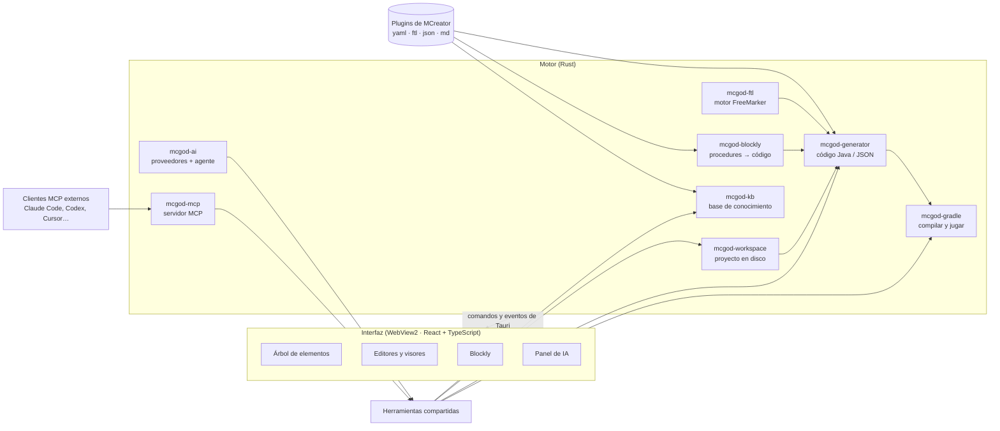

# 02 · Arquitectura

## Idea central

**Reescribimos el motor y la interfaz; reutilizamos los datos de MCreator.**

El 90 % de lo que MCreator sabe hacer (generadores, plantillas, bloques de procedures, listas de Minecraft, textos de ayuda) vive en archivos de datos dentro de sus plugins. Si nuestro motor en Rust sabe leer esos mismos archivos, obtenemos:

- **Paridad total:** los mismos tipos de elemento, generadores y bloques que MCreator, sin reescribir miles de plantillas a mano.
- **Actualizaciones gratis:** cuando MCreator agregue una versión nueva de Minecraft, traemos sus plugins nuevos.
- **Proyectos compatibles:** se pueden abrir workspaces existentes de MCreator (`.mcreator` + `elements/*.mod.json`).

Lo que sí reescribimos desde cero: todo el código Java (≈162 500 líneas), empezando por el motor y siguiendo con la interfaz.

## Vista general

## Piezas

| Pieza | Lenguaje | Responsabilidad |
|---|---|---|
| `app/` | TypeScript + React | Interfaz. Se muestra con WebView2 a través de Tauri |
| `app/src-tauri` | Rust | Puente entre interfaz y motor: comandos, eventos, ventanas |
| `mcgod-workspace` | Rust | Leer y escribir proyectos en el formato de MCreator; referencias entre elementos |
| `mcgod-ftl` | Rust | Intérprete compatible con FreeMarker 2.3 (lo que usan las plantillas) |
| `mcgod-generator` | Rust | Cargar `generator.yaml` y `*.definition.yaml`, ejecutar plantillas, ordenar imports |
| `mcgod-blockly` | Rust | Convertir el XML de Blockly de un procedure en código, usando las plantillas de cada bloque |
| `mcgod-gradle` | Rust | Ejecutar `gradlew` (compilar, `runClient`, exportar) y transmitir la consola en vivo |
| `mcgod-ai` | Rust | Conectores a proveedores (Anthropic, OpenAI y compatibles, Gemini, DeepSeek, Ollama local) y el ciclo del agente |
| `mcgod-kb` | Rust | Índice y búsqueda sobre la ayuda de MCreator + documentación propia de modding |
| `mcgod-mcp` | Rust | Servidor MCP que expone las mismas herramientas que usa el chat integrado |

Las piezas se irán creando como *crates* de un workspace de Cargo conforme lleguen sus fases (ver [03-hoja-de-ruta.md](03-hoja-de-ruta.md)). Hoy existen `app/src-tauri`, `crates/mcgod-workspace`, `crates/mcgod-gradle` y `crates/mcgod-ftl`.

### El intérprete de plantillas (`mcgod-ftl`)

Implementa el subconjunto de FreeMarker 2.3 que usan los generadores de MCreator, medido sobre sus plantillas: `if`, `list` con `sep` y `else`, `assign`/`local`/`global` (también con captura), `macro` con `nested`, `function`/`return`, `include`, `import`, `break`, 64 built-ins (los 41 que aparecen en las plantillas y otros afines), lambdas, rangos, `!`, `??` y `?interpret`.

Replica la configuración de MCreator (`DefaultFreemarkerConfiguration`):

- Números con el patrón `0.##########`: hasta 10 decimales, redondeo al par, sin separador de miles.
- Booleanos como `true`/`false` y sin escapado automático.
- Recorte de espacios: una línea que solo tiene etiquetas o comentarios no deja rastro en la salida.
- `<@javacompress>`: port de la directiva Java de MCreator que compacta espacios sin tocar los textos entre comillas.

Los objetos del generador (`settings`, `generator`, `w`, `data`…) se exponen con el rasgo `HostObject`: propiedades y métodos, como el BeansWrapper de FreeMarker.

### Cómo se compila y se abre Minecraft

`mcgod-gradle` llama al `gradlew` del proyecto igual que MCreator llama a Gradle (`GradleUtils.java`):

- **Java fijo:** `JAVA_HOME` y `-Porg.gradle.java.installations.paths` apuntan al JDK detectado, sin autodetección.
- **Entorno limpio:** se quitan `JAVA_TOOL_OPTIONS`, `GRADLE_OPTS`, `CI` y otras variables que cambian el resultado.
- **Opciones de MCreator:** `-Duser.language=en` (errores en inglés, fáciles de leer) y `-Declipse.application=net.mcreator` (ModDevGradle actúa como dentro de un IDE).
- **Salida en tandas:** cada 100 ms o 500 líneas, por un canal de Tauri. Minecraft en modo desarrollo escribe miles de líneas por segundo; la consola guarda las últimas 4,000.
- **Detener:** se mata el árbol del proceso `gradlew`. El daemon de Gradle detecta la desconexión, cancela la tarea y cierra Minecraft (comprobado con `runClient`). El daemon sigue vivo para que la siguiente compilación arranque rápido.
- **Una tarea a la vez.** Cerrar el proyecto, abrir otro o cerrar la app detiene la tarea en curso.

### Cómo se abre un proyecto hoy

1. La interfaz abre el selector de archivos (plugin de diálogo de Tauri) y recibe la ruta del `.mcreator`.
2. El comando `open_workspace` lee el archivo con `mcgod-workspace` en un hilo aparte, guarda el proyecto en recientes y devuelve un resumen: datos del mod, generador y lista de elementos con su estado.
3. Al elegir un elemento, `read_element` lee su `elements/<Nombre>.mod.json`.
4. Los errores llegan con un código estable (`notFound`, `invalidJson`…) y la interfaz los traduce; el detalle técnico se muestra aparte.

En el navegador (desarrollo), la interfaz usa un sustituto del motor; con `?demo` en la URL carga el proyecto de ejemplo de las pruebas.

## Un solo juego de herramientas para la IA

El chat integrado y el servidor MCP usan **exactamente las mismas herramientas** (crear elemento, editar campo, compilar, abrir el juego, leer consola, buscar en la base de conocimiento…). Así:

- Lo que una IA externa puede hacer por MCP, también lo puede hacer el chat interno, y al revés.
- Cada acción de la IA pasa por el motor y emite eventos a la interfaz: tú ves en tiempo real qué elemento cambia, qué campo y por qué.

El diseño de las herramientas parte de las 25 que ya tiene el MCP de MCreator (ver inventario §5).

## Interfaz

- **Tauri 2** + **React** + **TypeScript** + **Tailwind**.
- **Español e inglés**: todo texto visible vive en `app/src/i18n/locales/`. TypeScript y una prueba exigen que los dos idiomas tengan las mismas claves.
- **Blockly** y su JavaScript de MCreator funcionan tal cual dentro del WebView.
- **Visores 3D** con three.js (modelos OBJ, Java y Blockbench).
- **Editor de código** con Monaco (el de VS Code).
- **Ayuda en cada opción**: cada campo muestra su texto de ayuda y un botón "pregúntale a la IA".
- **Panel de IA a la derecha**, plegable, como en VS Code o JetBrains.

## Riesgos conocidos

| Riesgo | Cómo lo controlamos |
|---|---|
| FreeMarker es un lenguaje grande | Implementamos solo lo que usan las plantillas reales y lo medimos con pruebas |
| Las plantillas llaman 107 métodos Java | Los portamos uno a uno en Rust, con pruebas por método |
| El código generado podría diferir del de MCreator | Pruebas "golden": generar el mismo workspace con MCreator real y con el nuestro, y comparar |
| Roaster ordena imports y formatea | Implementar orden de imports propio; el formato exacto no es requisito si compila igual |
| Alcance enorme | Fases cortas con algo usable al final de cada una |
